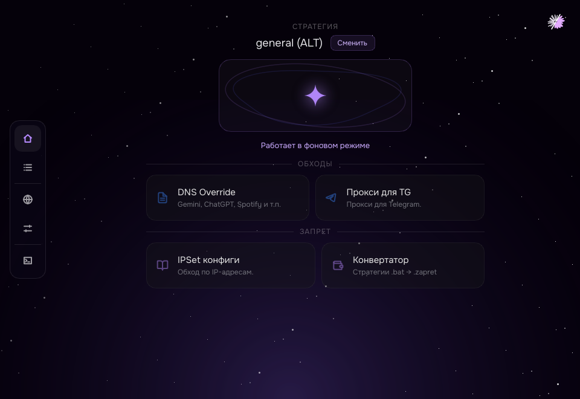
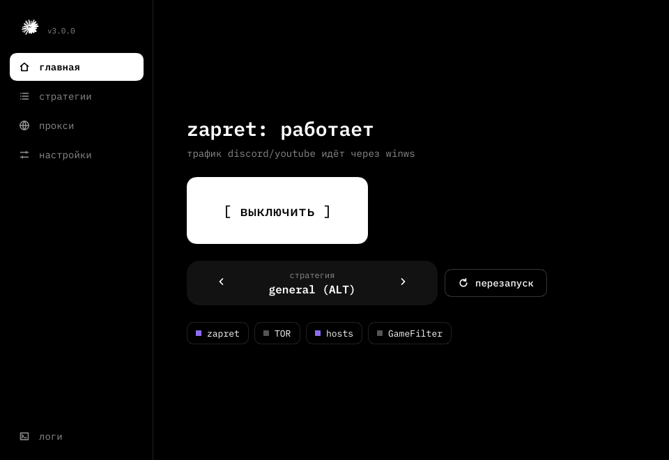
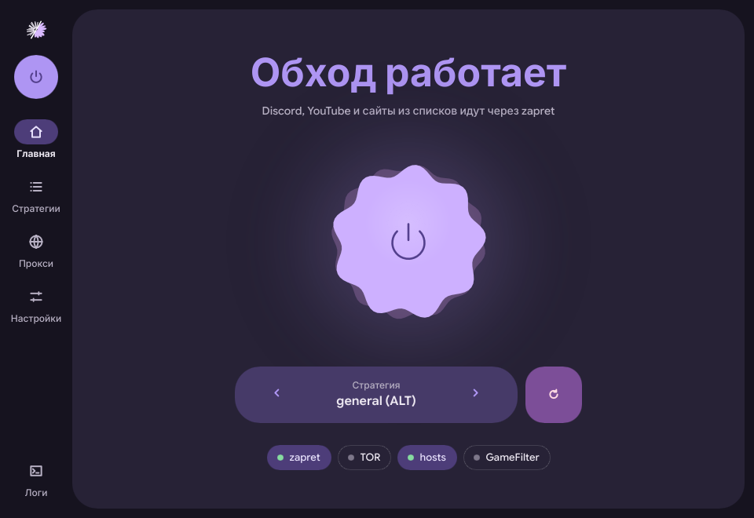

[rust.com]: https://img.shields.io/badge/rust-000000?style=for-the-badge&logo=rust&logoColor=white

[rust-url]: https://rust-lang.org/

[slint.com]: https://img.shields.io/badge/SLINT-2379F4?style=for-the-badge&logo=slint&logoColor=white

[slint-url]: https://slint.dev/

<br />
<div align="center">
  <a href="https://github.com/f1zzen/zust">
    
  </a>
  <br /> <br /><h1 align="center">Z.UST</h1> <p align="center">

<p align="center">
    Крайне простой интерфейс для работы с обходами блокировок.
    <br />
    <a href="https://t.me/zdotust"><strong>Подписаться на проект <3</strong></a>
    <br />
    <br />
    <a href="#what-is-this">Что это?</a>
    &middot;
    <a href="https://github.com/f1zzen/zust/issues/new">Жалоба на баг</a>
    &middot;
    <a href="https://t.me/fizzeeen">ТГК Создателя</a>
  </p>

<p align="center">

[![rust][rust.com]][rust-url]
    [![slint][slint.com]][slint-url]

</p>
</div>

<a id="what-is-this"></a>

## Что это?

Пытаясь помочь людям с настройкой обхода блокировок, я столкнулся с кучей проблем и "непониманием": начиная от установки и заканчивая запуском. Люди не соображали, куда что нажимать и откуда скачивать... И даже с детальнейшей инструкцией появлялась гора вопросов и разных косяков. В качестве решения я решил объединить популярные методы обхода в одно приложение - Z.UST ~~(пока только zapret)~~. Программа исправляет проблему десятки разных папок с запретом и собирает готовые решения для обхода в одной программе.

На данный момент присутствует три способа обхода блокировок, с разной концепцией и немного углублённой настройкой.

## Особенности

* **Синхронизация с zapret-discord-youtube от flowseal**: Если у вас включён запрет, вы это увидите в приложении.
* **Использование самостоятельных файлов**: вместо использования `.bat` файлов (как в `zapret-discord-youtube`) вы используете файлы с расширением `.zapret`, где включены лишь аргументы для запуска `winws.exe`. *(Для конвертации файлов достаточно нажать кнопку в меню)*
* **Возможность добавление пользовательских IPSet-ов**: добавляет возможность в использовании айписетов для обхода блокировок *(иногда добавить домен в list-general.txt недостаточно 🥹)*
* **Встроенный прокси**: прокси, для работы Telegram и скроллинга интернета без проблем, точно так же как и ВПН (но с нюансами, читать ниже).
* **Интерфейс**: включая внутренний редактор, настройки, оптимизация, лёгкая настройка и прочее..
* **Пять тем**: M3E, Тёплая, Моно, Классика (как в 2.0) и Лёгкая - для слабых ПК. Панель навигации можно поставить слева или справа.
* **Свои списки сайтов**: домены и IP для zapret добавляются прямо в приложении, без похода по папкам.
* **Уведомления**: Z.UST сообщит, если zapret перестал работать, TOR подключился или вышло обновление стратегий. Когда окно свёрнуто в трей - системным уведомлением.
* **Проверка обновлений**: о новой версии Z.UST приложение скажет само.
* **Windows, Linux и macOS**: одна и та же программа. На Linux zapret работает через nftables, на macOS - через pf.

<div align="center">
  
  
  
</div>

## Установка

Всё лежит в [релизах](https://github.com/f1zzen/zust/releases).

**Windows 10/11** - скачайте и запустите `Z.UST-setup.exe`. Установщик сам удалит Zust 2 (настройки сохранятся) и добавит Z.UST в меню "Пуск". Программа попросит права администратора: без них zapret не работает. Без установки: `Z.UST-windows.zip` - распакуйте и запустите `Z.UST.exe`.

**Linux** - скачайте `Z.UST-linux.sh` и запустите:

```
sh Z.UST-linux.sh
```

Установщик сам проверит систему и предложит поставить недостающее (`nftables`, `polkit`, а для TOR - `tor` и `obfs4proxy`). Нужен 64-битный дистрибутив на glibc 2.35+: Ubuntu 22.04, Debian 12, Fedora 36, Arch и новее. Удалить: `sh Z.UST-linux.sh --remove`.

**macOS 12 и новее** (Intel и Apple Silicon) - скачайте `Z.UST-macos.zip`, распакуйте и перетащите `Z.UST.app` в "Программы". Подписи Apple у программы нет, поэтому при первом запуске macOS её не откроет: зайдите в "Системные настройки" → "Конфиденциальность и безопасность" и нажмите "Всё равно открыть". TOR уже внутри, ставить ничего не нужно. Если zapret завис, выключить его можно так: `sudo launchctl bootout system/com.f1zzen.zust.zapret`.

> zapret на macOS работает на движке из [zapret-mac-discord-youtube](https://github.com/Flowseal/zapret-mac-discord-youtube) от flowseal.

**Android** - отдельное приложение с TOR и мостами, ссылка появится вместе с релизом.

- [x] Добавить обход через hosts
- [x] Автоматически обновлять bin-арники для zapret
- [x] Добавить обход через мосты TOR-а
- [x] Переписать проект на TailWind CSS с использованием разных библиотек
- [x] Добавить порт на мобильные-устройства (Android)
- [x] Добавить порт на линукс
- [x] Добавить порт на macOS
- [ ] ..и по мелочам

## Обходы в Z.UST

### zapret

Для обхода DPI-блокировок (РФ/РБ, а также стран со схожей цензурой: ОАЭ, Турция и т.д.) используется библиотека **zapret**. Принцип её работы основан на **фрагментации** — разделении интернет-пакетов на мелкие части и отправке модифицированных данных, которые сбивают фильтры провайдера (ТСПУ) с толку. Пока система пытается обработать такие фрагменты, основной запрос проходит тихо и незаметно, что позволяет открывать запрещённый контент.

Сама сборка основана на репозитории `zapret-discord-youtube` от **flowseal**, так как она является наиболее распространенной на текущий момент.

Стоит отметить, что автор оригинальной библиотеки `zapret` перевел проект в статус **EOL (End-Of-Life)**, прекратив выпуск крупных обновлений (только багфиксы). Тем не менее инструмент полностью сохраняет свою эффективность, а в будущем возможен переход на версию `zapret2`.

### Переопределение DNS (etc/hosts)

**zapret** не всегда способен обойти блокировки, установленные на стороне самих сайтов (например, когда ресурс сам ограничивает доступ для определённых стран) — в таких случаях применяется метод подмены DNS (как такового точного названия у него нет, но используются так же определяния как hosts, etc/hosts и подобные). Этот метод работает несколько иначе, чем обычный DNS, и во многом схож с прокси.

При использовании этого метода система *"уверяет"* браузер в том, что сайт **X** находится по адресу **Y**, где на самом деле расположен прокси-сервер. Все данные передаются в зашифрованном виде: вы отправляете название сервера через SNI и получаете зашифрованный ответ. Данный метод значительно эффективнее стандартных VPN или прокси, так как он не требует сложной настройки и практически не снижает скорость интернет-соединения. Однако, если IP-адрес прокси (**Y**) будет заблокирован, доступ к домену (**X**) может быть временно ограничен до обновления записей.

> Сам метод берёт список прокси от [dns.malw.link](https://info.dns.malw.link/hosts) и [flowseal!](https://github.com/Flowseal/zapret-discord-youtube/blob/main/.service/hosts)

### Прокси | TOR

Метод работает благодаря сети ТОР, сделанная ребятами из [Tor Project](https://support.torproject.org/ru/about-tor/how-tor-works/overview/). Ознакомиться можно на [Wikipedia](https://en.wikipedia.org/wiki/Tor_(network)#Operation). Многие могут путать с Tor Browser, но метод работает несколько иначе.

**На момент написании README реализация следующая:**

+ При подключении запрашиваются мосты [(?)](https://support.torproject.org/ru/relays/getting-started/what-is-a-bridge/) для создания подключения. Берутся они как локально, так и с workers.dev (подробнее ниже)
+ Создается файл конфигурации `torrc` с параметрами для улучшенной скорости.
+ Создаётся попытка подключения и настройки. Если всё прошло успешно, то ура.

Однако, у такого способа есть очень много плюсов и пару серьёзных минусов:

#### Плюсы:

+ Смена режима VPN и прокси моментальная, айпи меняется сразу. Без лагов как в ВПН.
+ В отличии от других VPN, которые могут сливать ваши данные — TOR предлагает анонимность благодаря своей архитектуре.
+ Вы можете включить режим прокси и использовать его для сторонних сервисов. Например для Telegram предусмотрена поддержка прямо в приложении. Если же на ваше приложение не предусмотрено модификаций/нативной поддержки для работы с прокси, всегда можно использовать [Proxifier](https://www.proxifier.com/) или его альтернативу с открытым кодом — [ProxyBridge](https://github.com/InterceptSuite/ProxyBridge). Для браузеров настоятельно рекомендуется использовать [расширение FoxyProxy](https://getfoxyproxy.org/) (если системный режим по некоторой-причине не работает)

#### Минусы:

- Выходной узел (то есть, ваш айпи) меняется часто (предположительно, 10 минут). На игры не влияет, но сайты могут запрашивать повторную авторизацию.
- Некоторые сайты не любят TOR, и принципиально не будут пускать вас. Особенно это проблема возникает при простом сёрфинге информации в каком-нибудь Google, где каждый ваш пятый запрос будет сопровождаться ответом *"А вы не робот?"*.
- Некоторые браузеры (OperaGX, Яндекс и другие) по неизвестной причине (кроме Яндекса XDD) не меняют ваш айпи при смене на системный режим. Это не означает что вы лишаетесь прокси, но означает что вам придётся скачать расширение FoxyProxy и настроить его самостоятельно

# Остальные обходы

### tg-ws-proxy и подобные

Данный метод работает **только** для телеграмма, перенаправляя трафик через WebSocket. Первоначальный метод был написан flowseal-ом. Данный метод предоставляет наилучшую скорость из возможных, но имеет в себе пару нюансов в сравнении с прокси на базе тора. Легче будет сравнить через таблицу для наглядной демонстрации.

| Сравнение                                      | Z.UST (TOR)                                           | TG-WS                     |
| ---------------------------------------------- | ----------------------------------------------------- | ------------------------- |
| Скорость                                       | Зависит от моста, в среднем 20 Mbps                   | Неотличимая/та-же         |
| Перебои                                        | Иногда                                                | Редко                     |
| Используется                                   | Для обхода блокировок, в том числе не связанных с ТГ. | Только телеграмм          |
| Автозапуск?                                    | Присутствует                                          | Отсутствует               |
| Если телеграмм подвергнется полной блокировке? | Будет работать                                        | Вероятнее всего, не будет |

Касательно последнего (честно) я не уверен. По сути в `server_hostname` указаны домены *.web.telegram.org:

```python
def _ws_domains(dc: int, is_media) -> List[str]:
    dc = _DC_OVERRIDES.get(dc, dc)
    if is_media is None or is_media:
        return [f'kws{dc}-1.web.telegram.org', f'kws{dc}.web.telegram.org']
    return [f'kws{dc}.web.telegram.org', f'kws{dc}-1.web.telegram.org']
```

Если накроют телеграмм по DPI, то метод просто потеряет актуальность. Да, это фиксится путём добавления домена telegram.org в запрет - но думаю в качестве сравнения выше сойдёт.

Выбирайте tg-ws если вам нужен стабильный и быстрый обход телеграмма.

Выбирайте прокси заста, если вам нужен в целом доступ в интернет и телеграмм.

UPD: Честно говоря я бы его добавил, но не вижу смысла. Прокси на данный момент работает (к моему удивлению) даже на LTE, так что.. да.

## OpenFlux

Честно говоря на компьютере я не пробовал, попробовал на телефоне. Я правда не понял зачем мне подключаться к аккаунта OpenFlux и прочее.. Конечно, может быть я просто недоглядел и не понял как им пользоваться - но интуитивно не понятно..

Что касается разбора самого проекта то скажу в кратце: возможно, в Z.UST он будет, но видоизменённый. **Причина?**

Z.UST в первую очередь претендует себя как приложение "нажал кнопку - готово", а OpenFlux подразумевает использование своего VPS сервера, что довольно таки проблематично и уже не будет иметь смысла - легче купить VPN.

Сам проект экспериментальный, шифрование по умолчанию выключено, могут забанить в конце-концов.. В общем, много нюансов. Поэтому я бы скорее подождал пока проект поживёт, а там скажем - имеет ли смысл добавлять. Но сама идея таки интересная.

### ВПН.

Не смотря на свою популярность на территории РФ с 2022 года, с ВПН-ами (в том числе бесплатными) ситуация тяжелая.

На момент 2026 года, Роскомнадзор ограничил доступ к как минимум 469 впн-сервисам. Что-уж говорить про бесплатные обходы: разработчики буквально питаются за счёт рекламы в приложении. Конечно, есть платные сервисы с обходами через белый список: но у некоторых даже 150 рублей в месяц нет что бы пользоваться интернетом.. Жалко.

В засте не будет предусмотрен бесплатный ВПН, так как (вероятнее всего) исход будет плачевным: либо сервера заблокируют очень быстро, либо мы просто не выдержим нагрузки. :sad:

## FAQ

<details>
  <summary><b>Q: ТАМ ВИРУСЫ!! Я боюсь скачивать</b></summary>
  <p>А теперь заходим и <b>внимательно</b> читаем
  <a href="https://github.com/Flowseal/zapret-discord-youtube">README от flowseal-а</a>.

Если лень вникать, то вкратце: <b>WinDivert</b> (библиотека для работы запрета) перехватывает сетевой трафик на уровне драйвера. Любой антивирус будет подозревать что вы скачиваете стилер. Может быть исправлю лживый детект когда-нибудь.. но сейчас лень.

Если уж параноите, можете глянуть исходные коды проекта и скомпилировать код самому. Делается это просто, спросите у нейронки если не знаете.</p>

</details>

<details>
  <summary><b>Q: Запрет перестал работать!!</b></summary>
  <p>В первую очередь <b>УБЕДИТЕСЬ</b> что дело именно в Z.UST-е. Проверьте файлы, актуальность стратегий и т.д. Если вы на 100% уверены что дело в Z.UST-е, то создавайте issue на гитхабе или пишите в ТГК проекта.</p>
</details>

<details>
  <summary><b>Q: Я очень хочу помочь проекту.. Как мне это сделать?</b></summary>
  <p>НА ДАННЫЙ МОМЕНТ над проектом работает один человек, поэтому любое предложение, финансовая поддержка или мотивация работать над чем-то приветствуется. (*^‿^*)

  Для связи по любой из тем выше смело обращайтесь в ТГК канал проекта (либо в личные сообщения, либо в коментарии).
  </p>

</details>

<details>
  <summary><b>Q: Прокси не работает, а точнее..</b></summary>
  <p>
    Если ожидание мостов занимает долгое время, просто подождите. Обычно дело в том, что Tor Project заблокирован в РФ - и для получения мостов НЕОБХОДИМО подождать для появления модаля с решением вашей проблемы.

  Тем не менее с прокси, наверное, самая больная тема на данный момент - нельзя точно сказать запустится он или нет. На момент написания статьи все возможные баги на стороне Z.UST-а пофикшены - но это не исключает возможности багов в будущем.
  </p>

</details>

<details>
  <summary><b>Q: Твой заст мне всё поломал!! (Или подобная неконструктивная критика)</b></summary>
  <p>
    - >> zust://net << -
  </p>
</details>

<details>
  <summary><b>Q: Я очень хочу попасть в список коммьюнити, что мне сделать?</b></summary>
  <p>
    Любой ваш вид творчества, любые деяния (в коммьюнити заста) или финансирование делают вас реально важным лицом во всей истории. Достаточно нарисовать что-то, помочь с чем-то, предложить что-то или в целом активничать в коммьюнити и попасть в списки.

  Тем нее менее, важно учесть что попадают люди на следующий релиз*.
  </p>

</details>

## Дополнительно

> Проект распространяется на условиях лицензии [MIT](https://github.com/f1zzen/zust) 📝

> Огромная благодарность создателю [zapret](https://github.com/bol-van/zapret) | [bolvan](https://github.com/bol-van/) и [flowseal](https://github.com/Flowseal/) за [zapret-discord-youtube](https://github.com/Flowseal/zapret-discord-youtube/) ( ´ ꒳ ` ) ♡

> Большая благодарность ребятам из [Tor Project](https://www.torproject.org/) (っ˘ω˘ς )

> Ещё одна благодарность создателю [info.dns.malw.link](https://info.dns.malw.link/hosts) | [malware](https://malw.link/) за способ обхода через hosts! (☆ω☆)

> Поддержать людей выше (или меня) можно тут: [malware](https://boosty.to/notmalware), [bol-van](https://boosty.to/notmalware), [Z.UST](https://boosty.to/zust/)

> Для связи напишите в телеграм канал [проекта](https://t.me/zdotust) или [создателя (меня)](https://t.me/fizzeeen). o(>< )o
